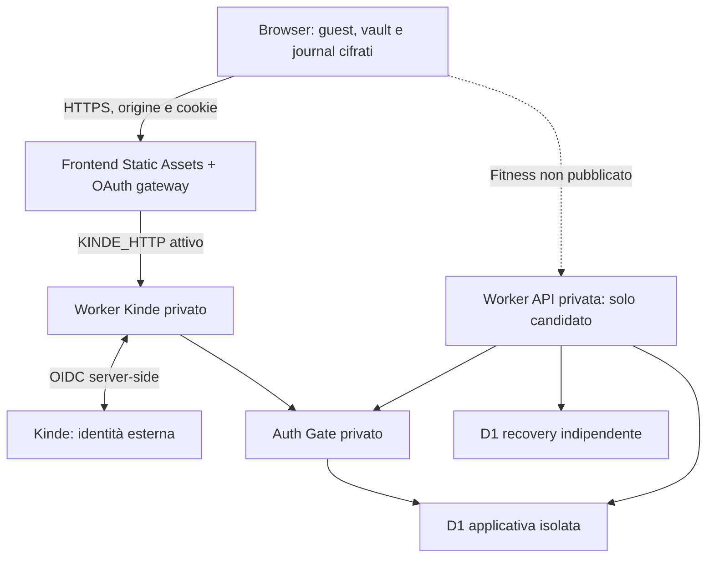

# CF-01 / ADR-2 — confini di fiducia e modello delle minacce Cloudflare

**Stato:** decisione architetturale per i componenti *candidati* Workers/D1. È una matrice di responsabilità, **non** un collaudo del percorso fitness pubblico, una certificazione privacy o un GO. Le autorizzazioni effettive restano nel codice trusted, nei vincoli SQL e nel provider. [ADR-1](kinde-owner-identity.md) definisce l'UID Kinde; [#1055](https://github.com/gernotfound/logbook/issues/1055) coordina i contratti ancora aperti.

**Fonti:** [AGENTS](../../AGENTS.md), [account](../../.agents/rules/account-lifecycle.md), [storage e sync](../../.agents/rules/storage-and-sync.md), [cifratura](../../.agents/rules/secure-storage.md), [consenso](../../.agents/rules/health-consent.md), [servizi](../../.agents/rules/external-services.md). La matrice sotto confronta le [Rules Firebase](../../firestore.rules) con il [gateway](../../cloudflare/auth-proxy.mjs), la [policy delle route](../../cloudflare/api-route-policy.mjs), l'[Auth Gate](../../cloudflare/auth/session-gate.mjs), l'[API privata](../../cloudflare/api/worker.mjs) e le [migrazioni D1](../../cloudflare/api/migrations/). Le Rules descrivono il backend precedente: **non** sono un secondo sistema autorizzativo per i nuovi dati Kinde.

## Decisione e flusso dei dati

Il browser è una **zona non fidata**: l'UID, gli header, le revisioni, gli envelope e i presunti ACK sono input, non autorità. Il guest usa soltanto la copia locale del proprio profilo. Il flusso Kinde pubblico attuale è limitato a OAuth, sessione e logout; il manifesto frontend non espone `D1_API` né le route `/v1/*`. Un futuro collegamento richiede un gate distinto, non discende dall'esistenza delle route candidate.

Il Worker Kinde verifica la risposta OIDC e crea una sessione applicativa casuale in D1; il frontend non interpreta token Kinde per concedere fitness. Auth Gate rilegge la sessione, l'epoch e le autorizzazioni dal *primary* D1. Le API di salute ricontrollano anche consenso, generazione, chiave cloud e registro recovery indipendente. I documenti business arrivano sul server solo come **ciphertext e metadati di replica**: la chiave ADK è casuale e distinta dalla DEK del dispositivo, ma il backend trusted può recuperarla tramite la KEK. Non è E2EE/zero-knowledge.

## Matrice Firestore Rules → boundary Workers/D1

| Proprietà da preservare | Controllo precedente (Firestore) | Autorità nel candidato Cloudflare | Failure da conservare |
| --- | --- | --- | --- |
| Proprietario e accesso | `isOwner(userId)`, `isActiveOwner` su `request.auth.uid`, email e revoca | UID derivato da `(iss, sub)` firmati; cookie casuale, `auth_principals` e `auth_sessions` in [`session-gate.mjs`](../../cloudflare/auth/session-gate.mjs); SQL owner `uid` in ogni lettura/scrittura | UID nel body, email uguale, cookie scaduto e A→B→A **non** autorizzano un altro owner |
| Sessione, CSRF, metodi e origine | Rules controllavano Auth; API legacy imponevano gate separati | [Policy comune](../../cloudflare/api-route-policy.mjs), gateway same-origin con allowlist di header, Worker privati con route/method/body limit, Auth Gate con hash cookie, CSRF quando richiesto, idle/absolute expiry ed epoch | Binding mancante, origin errata, risposta anomala, CSRF o sessione non verificabili: niente fallback pubblico o ACK |
| Consenso e maggiore età | `health_consent_withdrawals`, `matchesConsentEpoch`, job `account_deletions` | [`health_consent_acceptances`](../../cloudflare/api/migrations/0004_initial_consent.sql) immutabile, `sync_subjects`, versioni legali trusted, [consent Worker](../../cloudflare/api/consent-worker.mjs), recovery owner fence | Guest ≠ consenso account; revoca, nuovo epoch o policy non comprovata bloccano fitness e vecchio journal |
| Documento cifrato e schema | `isSealedCloudDocument`, `isValidDataSchema`, `isValidSync` | [Zod e controllo envelope](../../cloudflare/api/replica-contracts.mjs) a ingresso API; `sync_documents.envelope_json` e vincoli path/size nella [0001](../../cloudflare/api/migrations/0001_encrypted_replica.sql); il browser verifica AEAD dopo la lettura | Il SQL non autentica il contenuto AEAD e non legge plaintext; payload alterato/versione sconosciuta blocca hydration, non diventa archivio vuoto |
| Causalità, quota repliche, commit | `validReplicaControl*`, `hasProtocol3Writer`, atomicità Rules/Firestore | `sync_state` CAS, `sync_replicas`, trigger per receipt e mutazioni in 0001/0009/0018/0019, API [`d1-document-store.mjs`](../../cloudflare/api/d1-document-store.mjs); **5 membership** attive ma **16 slot causali** | Zero righe aggiornate, 409/428, retry concorrente o risposta persa non creano ACK; il journal locale resta durevole |
| Pagination e privato/pubblico | `boundedArchiveQuery`, `list` limitato, catalogo `get` pubblico | Path/limiti/post dei documenti e cursor/read revision nei Worker; catalogo statico candidato separato, non ancora pubblicato | Una scansione parziale non prova completezza; nessuna query client libera su D1 o esposizione del catalogo storico |
| Key custody e percorsi server-only | `user_data_keys`, revoche, activity, deletion jobs sempre `allow read, write: false` | [`cloud-key-store.mjs`](../../cloudflare/api/cloud-key-store.mjs) più SQL 0007/0011; chiamanti trusted per attività, diritti ed erasure; nessuna route diretta di gestione D1 | Chiave assente/diversa o record inatteso: non crearne una nuova sopra ciphertext esistente; i diritti non ereditano fitness |
| Cancellazione e recupero dopo restore | Delete client negati; job Admin e barrier revoca | D1 `RECOVERY_DB` distinta, [owner fence](../../cloudflare/recovery/independent-owner-fence.mjs), [deny account](../../cloudflare/recovery/account-erasure-denials.mjs), [runtime sync fence](../../cloudflare/recovery/runtime-sync-fence.mjs), erasure con prova terminale e Kinde per ultimo | Restore di una sola D1, lease scaduto, errore provider e risposta persa non possono resuscitare accesso o produrre `complete` inventato |

Il confronto è **per proprietà**, non una traduzione riga-per-riga: Firestore Rules validavano richieste client direttamente sul database; D1 è accessibile solo ai Worker. Il controllo per ciascun percorso deve trovarsi nel Worker trusted **e** nei predicati/trigger SQL pertinenti. Una policy di gateway, WAF o rate-limit non sostituisce quelle verifiche. L'assenza di un confronto esplicito nella matrice non autorizza a cancellare il vecchio guard senza dimostrare il sostituto.

## Minacce, protezioni attuali e limiti

| Minaccia / causa | Protezione candidata ispezionata | Residuo da verificare prima del GO |
| --- | --- | --- |
| Impersonificazione, login replay, CSRF, session fixation | PKCE/state/nonce e JWT verificati nel Worker Kinde; cookie random hashati; Auth Gate e SQL con expiry/epoch; origine/metodo e allowlist al gateway | Tenant email/password/Google, linking, reset/reauth e comportamento browser reali [#1057](https://github.com/gernotfound/logbook/issues/1057) |
| XSS, furto del profilo o chiave device | Vault AEAD device owner-scoped, ADK non persistita dal browser, chiavi device/cloud indipendenti | Nessuna promessa di E2EE; un codice malevolo same-origin e la perdita totale del profilo non sono mitigati da una chiave nello stesso profilo [#1059](https://github.com/gernotfound/logbook/issues/1059) |
| Scritture cross-owner, replay o lost ACK | Owner e session hash nei SELECT/INSERT; trigger CAS + receipt; journal cifrato locale prima della rete; registry recovery riletto | Multi-tab/device, replay, crash e quota su runtime isolato [#1058](https://github.com/gernotfound/logbook/issues/1058) |
| Revoca/ripristino durante I/O concorrente | Deny indipendente **prima** della transizione applicativa, verifica primaria e after-read; recovery `generation`/lease e cutoff terminali | **Non esiste transazione atomica cross-D1**: restore richiede quiescenza dei writer, snapshot coerente, pin esterno e prove anti-resurrection [#1062](https://github.com/gernotfound/logbook/issues/1062) |
| KEK persa, cambiata o non recuperabile | KEK secret server-only, envelope ADK v1 immutabile; binding `secret_text` verificato per presenza/tipo nei deploy privati | Custodia esterna della **stessa** KEK, restore testato e rotation non attestati [#1059](https://github.com/gernotfound/logbook/issues/1059) |
| Flood, quota Free o leak nei log | Rate bucket Worker, budget body per route, risposte no-store e errori fail-closed senza valori di segreto | IAM, limiti reali, WAF, CPU/righe, privacy dei log e impatto DoS da misurare [#1054](https://github.com/gernotfound/logbook/issues/1054), [#1061](https://github.com/gernotfound/logbook/issues/1061) |

## Perché non aggiungere altri servizi adesso

Workers + D1 applicativa + D1 recovery indipendente sono sufficienti **per modellare** richieste bounded, receipt CAS, sessione e fence; le prove esistenti non dimostrano che R2, KV, Queues o Durable Objects risolvano un limite misurato. Non li si introduce preventivamente. Se misurazioni reali evidenziano colli di bottiglia o SLA incompatibili, [#1054](https://github.com/gernotfound/logbook/issues/1054) valuterà alternative, costi e nuovi boundary prima di una decisione di prodotto. La separazione delle D1 deve essere verificata anche in IAM, restore e backup: due binding diversi **non** bastano a garantire isolamento operativo.

## Evidenze e criteri per cambiare il confine

- **Codice e regressioni locali:** [`cf03-auth-gate`](../../tests/cloudflare/cf03-auth-gate.node.mjs), [`cf02-documents-security`](../../tests/cloudflare/cf02-documents-security.node.mjs), [`cf05-cloud-key-custody`](../../tests/cloudflare/cf05-cloud-key-custody.node.mjs), [`cf08-independent-owner-fence`](../../tests/cloudflare/cf08-independent-owner-fence.node.mjs) e [`cf03-first-party-api-candidate`](../../tests/cloudflare/cf03-first-party-api-candidate.node.mjs) attraversano boundary di produzione con fixture sintetiche. CI exact-SHA e smoke provider restano prove diverse.
- **Readback provider del 26/11/2026:** quattro Worker senza cron; frontend `thelogbook.me` con `APP_ORIGIN`, `ASSETS`, `KINDE_HTTP` e **senza `D1_API`**; API privata con `DB`, `RECOVERY_DB`, `AUTH_GATE` e secret KEK solo per nome/tipo. D1 applicativa `eu`, ledger `0001–0020` via [run #4](https://github.com/gernotfound/logbook/actions/runs/45843978632); recovery `eu`, ledger `0001–0005` via [run #2](https://github.com/gernotfound/logbook/actions/runs/45823509877). La giurisdizione D1 non certifica residenza di Workers, log, Kinde/email o GDPR.
- **Attivazione vietata per deduzione:** `D1_API`, cron, fitness, OAuth/posta Production, DNS, billing, dismissioni e nuovi servizi richiedono tutti i gate pertinenti e le autorizzazioni specifiche. Per cambi a schema/protocollo, owner/epoch/consenso, ciphertext o recovery verificare tutta la catena client→gateway→trusted→SQL→readback→device, aggiungere regressioni negative e confrontare gli SHA esatti.

La presente ADR identifica **chi deve autorizzare cosa** e i limiti della difesa. Contratti delle versioni/rollback, test differenziali degli adapter e misure di capacità restano rispettivamente [ADR-3/4](https://github.com/gernotfound/logbook/issues/1055), [#1309](https://github.com/gernotfound/logbook/issues/1309) e [#1054](https://github.com/gernotfound/logbook/issues/1054).
